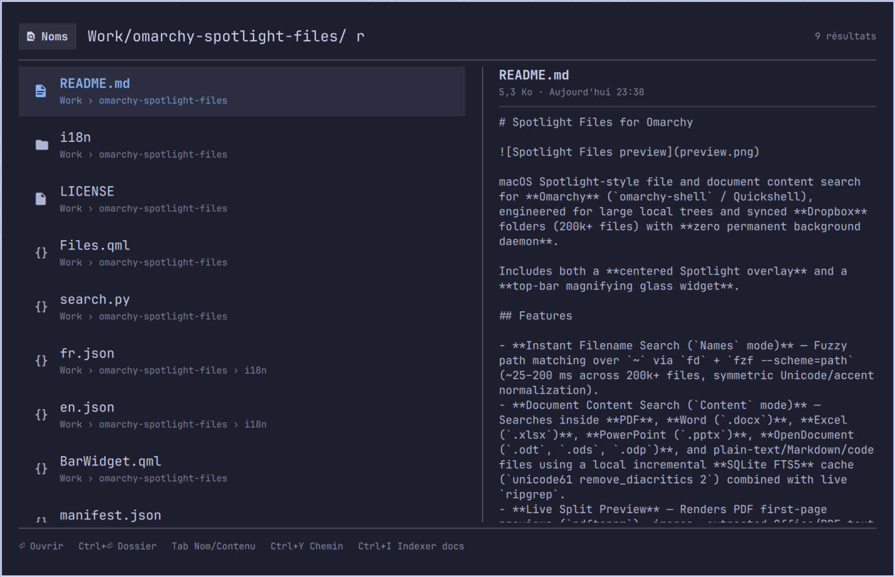

# Spotlight Files for Omarchy



macOS Spotlight-style file and document content search for **Omarchy** (`omarchy-shell` / Quickshell), engineered for large local trees and synced **Dropbox** folders (200k+ files) with **zero permanent background daemon**.

Includes both a **centered Spotlight overlay** and a **top-bar magnifying glass widget**.

## Features

- **Instant Filename Search (`Names` mode)** — Fuzzy path matching over `~` (paths discovered by `fd`) with a built-in, in-process fzf-style `--scheme=path` ranker: filename-over-folder bonus, word-start bonuses after `/` `-` `_` `.` and spaces, contiguous-match bonus, multiple space-separated terms (all must match, in any order), and case/accent-insensitive matching on both sides (`resume` finds `Résumé.pdf`, `été` finds `ete-2024`). Typically ~25–60 ms across 200k+ files.
- **Document Content Search (`Content` mode)** — Searches inside **PDF**, **Word (`.docx`)**, **Excel (`.xlsx`)**, **PowerPoint (`.pptx`)**, **OpenDocument (`.odt`, `.ods`, `.odp`)**, and plain-text/Markdown/code files using a local incremental **SQLite FTS5** cache (`unicode61 remove_diacritics 2`) combined with live `ripgrep`.
- **Live Split Preview** — Renders PDF first-page previews (`pdftoppm`), images, extracted Office/PDF text snippets around your search terms, plain-text/code files, and folder contents.
- **Top-Bar Icon (`bar-widget`)** — Native `BarIconButton` that adapts to your live Omarchy theme:
  - **Left-click**: toggle Spotlight overlay in filename mode.
  - **Right-click**: summon Spotlight overlay directly in document content mode.
- **Dropbox Integration** — Automatically detects personal and business Dropbox roots (`~/.dropbox/info.json`), badges synced items, and copies public Dropbox share links (`Ctrl+L`) via `dropbox-cli` over `stdin` to `wl-copy` (note: any system clipboard history manager you have enabled will record copied share links like any other clipboard entry).
- **Private Local Cache & Zero Background Daemon** — Runs strictly on demand in user space with no elevated privileges (`No sudo or pkexec is required`), storing its path list (plus derived case/accent-folded search mirrors), FTS5 index and rendered previews inside a `0700`/`0600` user-private directory (`~/.cache/io.github.thibaudberdin.spotlight-files/`).
- **No Search Terms or Document Paths in Process Arguments** — Filename queries are matched inside the Python helper itself, content queries reach `ripgrep` over `stdin`, and PDFs are passed to `pdftotext`/`pdftoppm` as `/dev/stdin`, so neither what you search for nor which document is being indexed or previewed shows up in the world-readable `/proc/<pid>/cmdline` of any helper process. (Explicit actions you trigger on a selected item — open, reveal, trash, Dropbox link — still hand that item's path to the corresponding desktop tool, and their confirmation notifications show the item's file name.)
- **Live Theme & Localization** — Follows Omarchy theme switches and language changes live (`en` and `fr` bundled).

## Installation

Add and enable the plugin with the Omarchy CLI:

```bash
omarchy plugin add https://github.com/ThibaudBerdin/omarchy-spotlight-files --enable
```

Enabling the plugin places the magnifying glass icon in the right section of your top bar by default. You can reposition it anywhere on the bar, for example right next to Dropbox:

```bash
omarchy bar move io.github.thibaudberdin.spotlight-files --after omarchy.dropbox
```

### Optional Hyprland Keybinding

The plugin does not modify your Hyprland configuration automatically. To bind `SUPER + D` (or any shortcut of your choice), add the following line to `~/.config/hypr/bindings.lua`:

```lua
o.bind("SUPER + D", "Spotlight Files", { panel = "io.github.thibaudberdin.spotlight-files" })
```

You can also toggle or summon specific modes from the command line:

```bash
omarchy-shell shell toggle io.github.thibaudberdin.spotlight-files
omarchy-shell shell summon io.github.thibaudberdin.spotlight-files '{"mode":"content"}'
```

## Removal

Remove the plugin with the Omarchy CLI:

```bash
omarchy plugin remove io.github.thibaudberdin.spotlight-files
```

If you added a custom keybinding in `~/.config/hypr/bindings.lua`, remove that line as well. To delete the local search/preview cache and optional config file:

```bash
rm -rf ~/.cache/io.github.thibaudberdin.spotlight-files ~/.config/omarchy/spotlight-files.json
```

## External Dependencies

All core dependencies are standard userland utilities preinstalled on Omarchy / Arch Linux:

| Dependency | Binary | Purpose | Required |
|---|---|---|---|
| `python` | `python3` | Search, built-in fuzzy path ranking, XML Office extraction, and SQLite FTS5 backend | Yes |
| `fd` | `fd` | Fast filesystem path and recent-file discovery | Yes |
| `ripgrep` | `rg` | Live plain-text, Markdown, CSV, and code content search | Yes |
| `poppler` | `pdftotext`, `pdftoppm` | PDF text extraction and page-1 visual preview | Recommended |
| `glib2` | `gdbus`, `gio` | Reveal in file manager (`FileManager1`) and move to trash | Yes |
| `wl-clipboard` | `wl-copy` | Copy file paths and Dropbox links to Wayland clipboard | Yes |
| `xdg-utils` | `xdg-open` | Open files and folders in default desktop apps | Yes |
| `dropbox-cli` | `dropbox-cli` | Generate Dropbox share links (`Ctrl+L`) | Optional |

## Keyboard Shortcuts & Search Prefixes

| Key / Prefix | Action |
|---|---|
| `Enter` | Open selected file or folder |
| `Ctrl + Enter` | Reveal selected item in file manager |
| `Shift + Enter` | Filter inside the selected folder |
| `Tab` / `Ctrl + G` | Switch between **Names** and **Content** modes |
| `Ctrl + I` | Start/stop incremental FTS5 indexing of all PDFs & Office documents |
| `Ctrl + Y` | Copy full path to clipboard |
| `Ctrl + L` | Copy Dropbox share link to clipboard (for files inside Dropbox) |
| `Ctrl + Delete` | Move selected item to trash |
| `Esc` | Clear search input, or close overlay if empty |
| `?query` or `c:query` | Search inside document contents directly from Names mode |
| `pdf:`, `doc:`, `xls:`, `img:`, `dir:` | Restrict results by type (chainable, e.g. `?pdf: invoice`) |

## Configuration (Optional)

You can customize excluded directories and the maximum indexed text size per document by creating `~/.config/omarchy/spotlight-files.json`:

```json
{
  "excludes": [
    ".git",
    "node_modules",
    "__MACOSX",
    ".dropbox",
    ".dropbox-dist",
    ".dropbox.cache",
    "target",
    "venv",
    ".venv",
    "__pycache__",
    ".next",
    "dist",
    "build"
  ],
  "maxIndexedTextBytes": 350000
}
```

## License

Released under the [MIT License](LICENSE).
